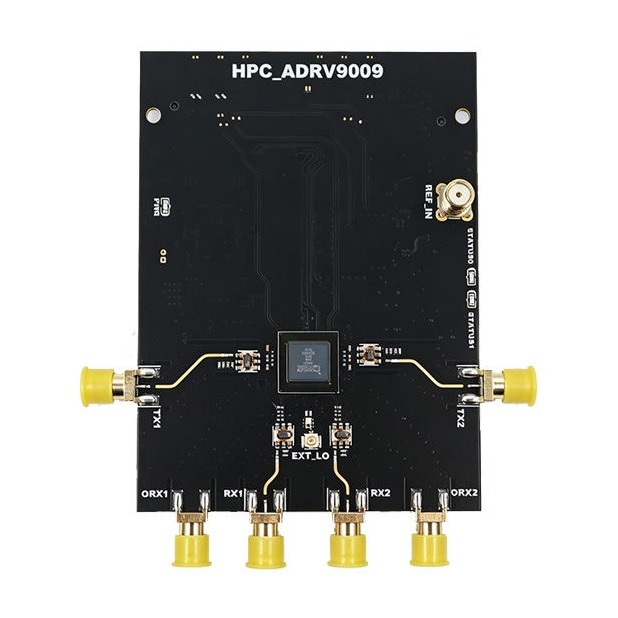
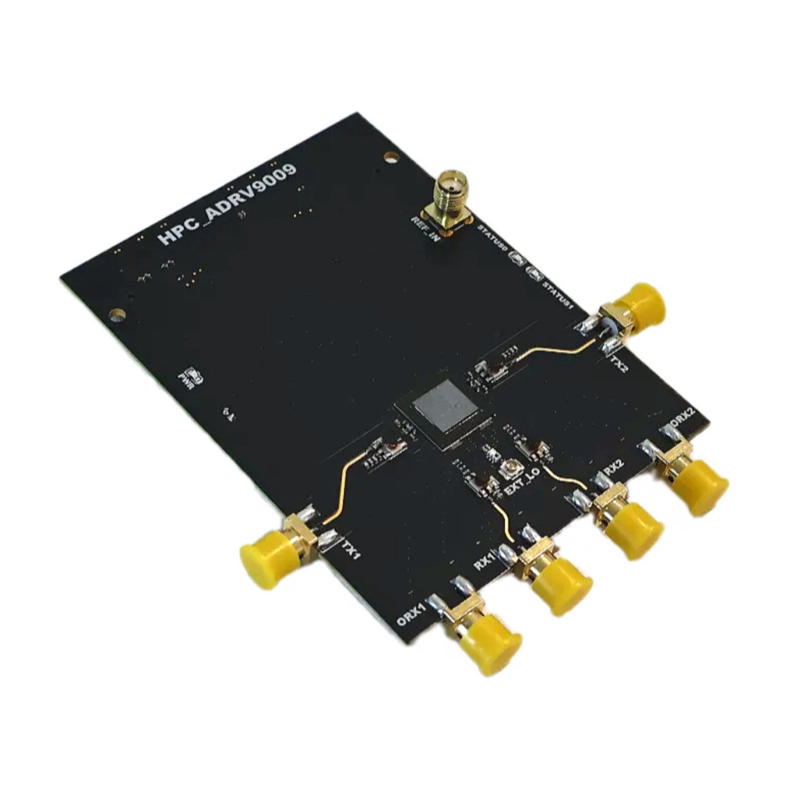

# FMC-ADRV9009

Hardware files, Vivado reference designs and evaluation files for the **OpenSourceSDRLab FMC-ADRV9009**, a high-performance FMC (HPC) card built around the Analog Devices ADRV9009 RF transceiver.

  
  

## Product link

<https://opensourcesdrlab.com/products/opensourcesdrlab-new-fmc-adrv9009-board-high-performance-board>

## About the board

- RF transceiver: Analog Devices **ADRV9009**, with two transmit, two receive and two observation-receive channels on SMA connectors (TX1/TX2, RX1/RX2, ORX1/ORX2)
- Clocking: **AD9528** clock generator, external reference input (REF_IN) and external LO input (EXT_LO)
- Interface: FMC **HPC** connector, JESD204B to the carrier FPGA
- Tested carriers: Xilinx **ZC706** (XC7Z045) and the XC7Z100 "7100" carrier
- Reference designs: Vivado **2021.1**, bare-metal (no OS)

## Quick start

1. Write the SD evaluation image from the [Releases](../../releases) page to a microSD card.
2. Copy the updated boot files to the card's BOOT partition and boot the ZC706 from SD.
3. Set the board IP to `192.168.1.10` and connect with the ADRV9009 Transceiver Evaluation Software from Analog Devices.

The full steps are in the **[Quick Start Guide](docs/Quick-Start-Guide.md)** ([PDF](docs/Quick-Start-Guide.pdf)).

## Repository layout

| Path | Contents |
|---|---|
| `hardware/` | Board schematic (PDF) |
| `vivado/ZC706/` | Vivado project sources (PL) and bare-metal application sources (PS) for the ZC706 |
| `vivado/7100/` | The same design for the XC7Z100 "7100" carrier |
| `vivado/*/FMC_ADRV9009_PS/src/firmware/` | Instructions for downloading the Analog Devices Talise firmware headers, which are not included (licence) |
| `docs/` | Quick Start Guide (Markdown and PDF) |
| `images/` | Product photos |

## Downloads (Releases)

Large files are attached to the [Releases](../../releases) page instead of being stored in the repository:

| File | Contents |
|---|---|
| `ADRV9009-eval-SD-image-20161130.img.xz` | SD-card image for the evaluation software (7.6 GB after decompression) |
| `FMC-ADRV9009_eval-boot-files.zip` | Updated ZC706 boot files and the test configuration `ADRV9009_Test_MAX.xml` |
| `FMC-ADRV9009_ZC706_prebuilt_Vivado2021.1.zip` | Prebuilt files for the ZC706: bitstream, `.xsa`, FSBL and application `.elf` |
| `FMC-ADRV9009_7100_prebuilt_Vivado2021.1.zip` | Prebuilt files for the 7100 carrier: bitstream, `.xsa`, FSBL and application `.elf` |
| `SHA256SUMS.txt` | SHA-256 checksums of the files above |

Check a download with `shasum -a 256 -c SHA256SUMS.txt` (macOS / Linux) or `certutil -hashfile <file> SHA256` (Windows).

## Licence

Files created by OpenSourceSDRLab are released under the [Apache License 2.0](LICENSE). Parts of the reference designs come from Analog Devices and Xilinx/AMD and remain under their own licences; see [NOTICE.md](NOTICE.md).

## Support

- Email: support@opensourcesdrlab.com
- Forum: <https://forum.opensourcesdrlab.com>
- Discord: <https://discord.gg/nnxY6DkmvT>
- Blog and user manuals: <https://blog.opensourcesdrlab.com>

---
© 2026 OpenSourceSDRLab. All rights reserved. · <a href="https://www.opensourcesdrlab.com">www.opensourcesdrlab.com</a>
